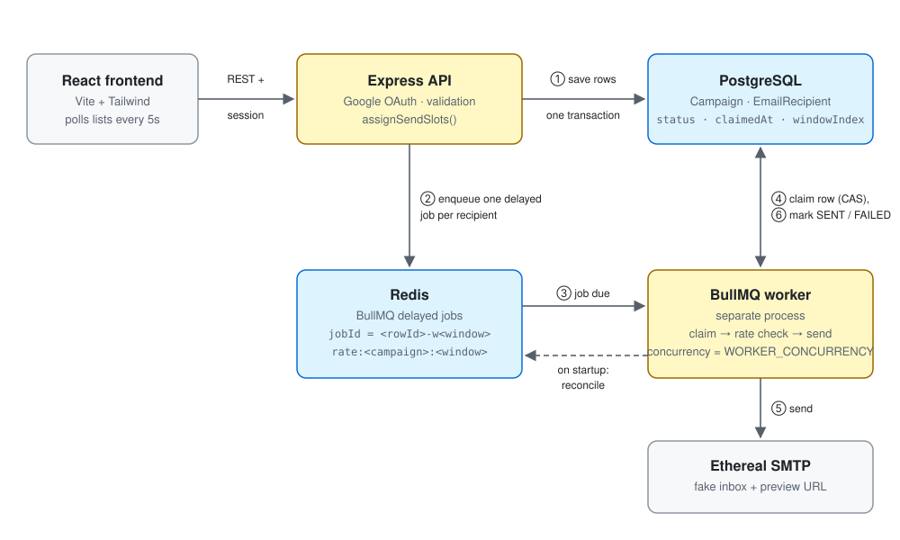
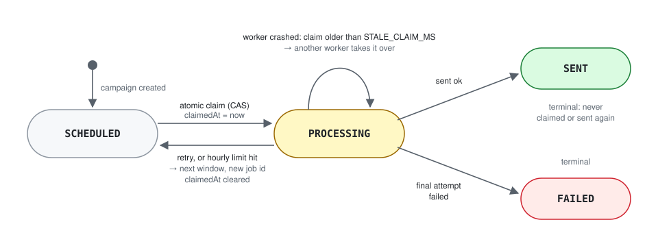

# ReachInbox Scheduler


A full-stack app that lets a Google-authenticated user upload a list of recipients, compose an
email, and schedule it to go out with a configurable per-email delay and a per-hour send limit.
Sending is done through **BullMQ + Redis** delayed jobs (no cron), emails go out via
**Ethereal** (a fake SMTP inbox with preview links), and every recipient is persisted in
**PostgreSQL** so nothing is lost across a server/worker restart.

<!-- TODO: add demo GIF here -->

<!--
Screenshots: save them in docs/images/ with these names, then uncomment this block.

| Login | Compose | Scheduled | Sent |
|---|---|---|---|
|  |  |  |  |
-->



## Highlights

- **No cron, no polling**: every email is one delayed BullMQ job that Redis wakes up exactly when
  it's due.
- **Survives restarts and crashes**: rows live in Postgres, jobs in Redis. A worker that dies
  mid-send has its claim taken over after `STALE_CLAIM_MS`, and a startup reconcile pass
  re-creates any job that never made it into Redis.
- **Never sends twice**: an atomic compare-and-swap on the row's status is the duplicate-send
  guard. `SENT` / `FAILED` rows can never be claimed again.
- **Hourly limit across processes**: enforced with a Redis counter, so it holds with any
  `WORKER_CONCURRENCY` or number of workers. Overflow rolls into the next hour instead of failing.
- **Validated on the server**: recipients are re-checked and deduped, with caps on recipients,
  subject/body length, delay and hourly limit.

## Quick start

Assumes Docker, Node.js and Google OAuth credentials (see [step 2](#2-create-google-oauth-credentials)).

```bash
docker compose up -d                 # Postgres + Redis
cp .env.example .env                 # then fill in GOOGLE_CLIENT_ID / GOOGLE_CLIENT_SECRET
echo "VITE_API_URL=http://localhost:4000" > frontend/.env

cd backend && npm install && npm run prisma:migrate && cd ..
cd frontend && npm install && cd ..

# then, in three separate terminals:
cd backend && npm run dev            # API on :4000
cd backend && npm run worker         # worker
cd frontend && npm run dev           # UI on :5173
```

The full step-by-step setup is below.

## Stack

- Backend: Express + TypeScript, Prisma ORM, PostgreSQL, BullMQ + Redis, Passport (Google OAuth),
  Nodemailer + Ethereal
- Frontend: React + TypeScript + Vite + Tailwind CSS
- Infra: `docker-compose.yml` for Postgres + Redis (optional — native installs work too)

## Project layout

```
reachinbox-scheduler/
├── backend/
│   ├── prisma/              schema.prisma + migrations
│   └── src/
│       ├── config/          env, Redis, Passport (Google OAuth)
│       ├── controllers/     auth, campaigns, emails, recipients
│       ├── queues/          BullMQ queue + job id scheme
│       ├── routes/          Express routers
│       ├── services/        scheduler, rate limiter, mailer, recipient parser, reconcile
│       │   └── __tests__/   Vitest unit tests
│       ├── types/           Express.User augmentation
│       ├── workers/         emailWorker.ts (separate process)
│       ├── app.ts           Express app
│       └── server.ts        API entry point
├── frontend/
│   └── src/
│       ├── components/      compose form, email lists/detail, sidebar, UI primitives
│       ├── pages/           Login, Dashboard
│       └── services/        typed API client
├── docs/images/             README diagrams
├── docker-compose.yml       Postgres 16 + Redis 7
└── .env.example
```

---

## 1. Prerequisites

- Node.js 18+ to run the app. **Node 20.19+ (or 22.12+) to run the backend tests**, because
  Vitest 3 uses Vite 7.
- PostgreSQL 14+ and Redis 6+ — either:
  - **Docker**: `docker compose up -d` from the repo root, or
  - **Native installs**: Postgres running on `localhost:5432` and Redis on `localhost:6379`
    (on Windows, Redis has no official build — [Memurai](https://www.memurai.com/get-memurai)'s
    free Developer edition is a drop-in Redis-protocol-compatible service)
- A Google Cloud OAuth Client ID (see next section)

## 2. Create Google OAuth credentials

1. Go to the [Google Cloud Console](https://console.cloud.google.com/) and create a new project
   (or reuse one).
2. **APIs & Services → OAuth consent screen**: choose "External", fill in an app name and your
   email as support/developer contact, add your own Google account under "Test users" (needed
   while the app is in "Testing" publishing status), and save.
3. **APIs & Services → Credentials → Create Credentials → OAuth client ID**:
   - Application type: **Web application**
   - Authorized JavaScript origins: `http://localhost:5173`
   - Authorized redirect URIs: `http://localhost:4000/auth/google/callback`
4. Copy the generated **Client ID** and **Client secret**.

## 3. Set up Ethereal Email

[Ethereal](https://ethereal.email/) is a fake SMTP service for testing — it never delivers to a
real inbox, it just gives you a preview link per message so you can prove an email was sent.

You don't have to do anything here by default: the worker calls `nodemailer.createTestAccount()`
on first run, prints a fresh throwaway Ethereal user/pass to the console, and uses it for the rest
of that process's lifetime. If you'd rather reuse the same inbox across restarts (so old preview
links keep working), create one manually at https://ethereal.email/create and put the credentials
in `ETHEREAL_USER` / `ETHEREAL_PASS` (see env vars below).

## 4. Configure environment variables

```bash
cp .env.example .env
```

| Variable | Required | Notes |
|---|---|---|
| `PORT` | — | API port, default `4000` |
| `FRONTEND_URL` | — | used for CORS + OAuth redirect, default `http://localhost:5173` |
| `DATABASE_URL` | ✅ | Postgres connection string — match your local user/password/db |
| `REDIS_HOST` / `REDIS_PORT` | — | defaults `localhost` / `6379` |
| `SESSION_SECRET` | ✅ | any random string, signs the session cookie |
| `GOOGLE_CLIENT_ID` / `GOOGLE_CLIENT_SECRET` | ✅ | from step 2 |
| `GOOGLE_CALLBACK_URL` | — | must exactly match the redirect URI registered in Google Cloud |
| `WORKER_CONCURRENCY` | — | how many BullMQ jobs the worker processes at once, default `5` |
| `STALE_CLAIM_MS` | — | how long (ms) a `PROCESSING` claim is honoured before another worker may take it over, default `300000` (5 min) |
| `MAX_RECIPIENTS` | — | maximum recipients per campaign, default `5000` |
| `ETHEREAL_USER` / `ETHEREAL_PASS` | — | optional, see step 3 |

Also create `frontend/.env`:

```
VITE_API_URL=http://localhost:4000
```

## 5. Install dependencies & set up the database

```bash
cd backend
npm install
npm run prisma:migrate    # applies all migrations (User / Campaign / EmailRecipient tables)
cd ../frontend
npm install
```

## 6. Running the backend

The API server and the BullMQ worker are **separate processes** — that's intentional, so the
worker keeps draining scheduled sends even if you restart the API, and vice versa. Both need
Postgres and Redis already running (steps 1–5 above).

```bash
# Terminal 1 — Express API (auth, campaign creation, dashboard endpoints)
cd backend
npm run dev

# Terminal 2 — BullMQ worker (claims due jobs, rate-limits, sends via Ethereal)
cd backend
npm run worker
```

`npm run dev` uses `ts-node-dev` with `--respawn`, so both restart automatically on file changes.
For a production-style run: `npm run build` then `npm start` / `npm run start:worker`.

On startup the worker logs a reconcile line before it starts processing, e.g.
`[worker] Reconcile: checked 12 pending row(s), re-enqueued 0 missing job(s)`.

**Backend scripts** (`cd backend`):

| Script | What it does |
|---|---|
| `npm run dev` | API with auto-restart (`ts-node-dev`) |
| `npm run worker` | BullMQ worker with auto-restart |
| `npm run build` | compile TypeScript to `dist/` |
| `npm start` / `npm run start:worker` | run the compiled API / worker |
| `npm test` | run the Vitest unit tests |
| `npm run prisma:migrate` | apply migrations (`prisma migrate dev`) |
| `npm run prisma:generate` | regenerate the Prisma client |
| `npm run prisma:studio` | browse the database in Prisma Studio |

## 7. Running the frontend

```bash
cd frontend
npm run dev
```

Open http://localhost:5173, sign in with Google, and you should see your name, email, and photo
in the sidebar.

## 8. Try it end to end

1. **Compose**: enter a subject/body, then click **Upload List** to pick a `.csv` or `.txt` file
   of recipient emails — one per line, or a column in a CSV. Invalid/duplicate entries are
   filtered out automatically; valid ones appear as removable chips in the To field.
2. Open the **Send Later** picker (clock icon), pick a start time a minute or two out, set the
   delay and hourly limit, then click **Send Later** to schedule.
3. **Scheduled**: rows appear immediately with status `Scheduled`, and drain out as their send
   time arrives (auto-refreshes every 5s).
4. **Sent**: completed rows land here with a clickable **Preview** link — that's the real
   Ethereal inbox showing the email your worker sent.

### Restart / durability test

1. Schedule a batch with a start time ~5 minutes out.
2. Stop both `npm run dev` (API) and `npm run worker` (Ctrl+C).
3. Start them again (`npm run dev`, `npm run worker`).
4. The emails still land in the **Sent** tab at their original scheduled time — the recipient rows
   live in Postgres and the delayed jobs live in Redis, so nothing was lost. Already-sent rows are
   never re-sent (the worker checks/claims each row's status before sending).

### Rate-limit test

Schedule more recipients than your hourly limit (e.g. 120 recipients, hourly limit 50, delay 1s).
Watch the **Scheduled** tab: the first 50 drain quickly, then the remaining rows' status pill time
rolls forward into the next hour window (still spaced out by your delay, just starting an hour
later) instead of failing — the limit is enforced via an atomic Redis counter
(`rate:<campaignId>:<windowIndex>`), not an in-process variable, so it stays correct even with
`WORKER_CONCURRENCY` > 1 or multiple worker processes running.

### Crash-recovery test

1. Schedule a few emails a minute or two out and start the worker.
2. Kill the worker (Ctrl+C) right as sends are happening, then start it again.
3. Any row left in `PROCESSING` is picked up again once its claim is older than `STALE_CLAIM_MS`.
   Set e.g. `STALE_CLAIM_MS=30000` in `.env` to see this quickly. Rows that already reached
   `SENT` are not sent again.

## 9. Running tests

```bash
cd backend
npm test
```

Unit tests (Vitest) cover the send-slot scheduler (`services/scheduler.ts`) and the recipient
file parser (`services/recipientParser.ts`). They're pure functions, so no Postgres or Redis is
needed.

---

## API reference

All `/api/*` routes need a logged-in session (cookie from the Google login) and return `401`
otherwise.

| Method | Path | Description |
|---|---|---|
| `GET` | `/auth/google` | start Google OAuth login |
| `GET` | `/auth/google/callback` | OAuth callback, redirects to `FRONTEND_URL` |
| `GET` | `/auth/me` | current user (`id`, `name`, `email`, `photoUrl`) |
| `POST` | `/auth/logout` | end the session |
| `POST` | `/api/recipients/preview` | multipart `file` (.csv/.txt, max 5 MB) → `{ count, recipients, invalidCount }` |
| `POST` | `/api/campaigns` | create and schedule a campaign (see below) |
| `GET` | `/api/emails/scheduled` | your `SCHEDULED` + `PROCESSING` rows (latest 500) |
| `GET` | `/api/emails/sent` | your `SENT` + `FAILED` rows (latest 500) |
| `GET` | `/health` | liveness check |

**`POST /api/campaigns`** body:

```json
{
  "subject": "Hello",
  "body": "Plain-text body",
  "recipients": ["a@example.com", "b@example.com"],
  "startTime": "2026-11-24T15:00:00.000Z",
  "delayMs": 2000,
  "hourlyLimit": 50
}
```

Validation (any failure returns `400` with an `error` message):

| Field | Rule |
|---|---|
| `recipients` | trimmed, lowercased, deduped and checked against the same email regex as the upload parser. Invalid entries are dropped and counted. At least 1 valid entry, at most `MAX_RECIPIENTS` (default 5000) |
| `subject` | required, ≤ 200 characters |
| `body` | required, ≤ 50,000 characters |
| `startTime` | valid date, no more than 1 minute in the past |
| `delayMs` | 0 – 3,600,000 (1 hour) |
| `hourlyLimit` | whole number, 1 – 10,000 |

Response `201`:

```json
{
  "campaignId": "…",
  "scheduled": 2,
  "invalidSkipped": 0,
  "firstSendAt": "2026-11-24T15:00:00.000Z",
  "lastSendAt": "2026-11-24T15:00:02.000Z"
}
```

If the rows were saved but the jobs couldn't be queued (e.g. Redis unavailable), it still returns
`201` with an extra `warning` field. The worker's startup reconcile pass queues those rows later.

---

## Architecture overview


1. The API validates the request, runs `assignSendSlots()` and saves the campaign plus all
   recipient rows in **one Postgres transaction**.
2. It then adds one **delayed BullMQ job** per recipient to Redis.
3. When a job is due, Redis hands it to the worker (a separate process).
4. The worker **atomically claims** the row in Postgres.
5. It checks the per-hour Redis counter, then sends through Ethereal.
6. It marks the row `SENT` (or `FAILED` after the last retry).

### How scheduling works

When a campaign is created (`campaigns.controller.ts`), `services/scheduler.ts` runs a single
pass over the recipient list, assigning each one a `scheduledAt` and an hour-relative
`windowIndex`:

```
currentTime = startTime
for each recipient:
  windowIndex = floor((currentTime - startTime) / 1hr)
  if count[windowIndex] >= hourlyLimit: jump currentTime to the next hour boundary
  assign recipient -> currentTime
  currentTime += delayMs
```

Each recipient becomes one `EmailRecipient` row plus one BullMQ job
(`emailQueue.add(..., { delay: scheduledAt - now })`) — Redis wakes the worker for that job at
the right time, no polling or cron involved.

### How persistence on restart is handled

Every recipient row moves through these states:



- Every recipient's data (subject/body/recipient/status/times) lives in **Postgres**, not memory.
  A campaign and all of its recipient rows are written in **one transaction**, so a campaign is
  never half-created.
- Every pending send is a **delayed job in Redis** (BullMQ), not a `setTimeout` in the API
  process. Restarting the API only affects HTTP requests being served that instant; restarting
  the worker just means BullMQ resumes handing it due jobs once it reconnects.
- **Deterministic job ids**: each job's id is `<recipientId>-w<windowIndex>` (see
  `emailJobId()` in `queues/emailQueue.ts`). Campaign creation, rate-limit deferral and the
  reconcile pass all derive it from the row's current state, so re-adding a job that's already
  queued is a no-op. A job whose id doesn't match its row's current window is obsolete and is
  skipped.
- **Atomic claim**: before sending, the worker does a compare-and-swap
  (`updateMany ... WHERE id=? AND (status='SCHEDULED' OR (status='PROCESSING' AND claimedAt is
  stale))`) that sets `status='PROCESSING'` and `claimedAt=now`. Whichever attempt loses sees 0
  rows affected and doesn't send. `SENT` and `FAILED` rows never match, so they are never
  re-sent. `claimedAt` is cleared when a row moves to `SENT`, `FAILED` or back to `SCHEDULED`.
- **Stale-claim takeover**: if a worker crashes after claiming a row but before marking it
  `SENT`, the row is left `PROCESSING`. A claim older than `STALE_CLAIM_MS` (default 5 min) is
  considered abandoned and can be claimed again. When BullMQ re-runs the stalled job before the
  claim has gone stale, the worker doesn't drop it. It moves the job back to delayed until the
  claim expires, then re-checks. SMTP timeouts in `services/mailer.ts` keep a single send well
  under that window, so a slow (but alive) send isn't mistaken for a crash.
- **Startup reconcile pass**: the API commits rows to Postgres and then enqueues jobs. If Redis
  is down or the API dies in between, the request still returns `201` (with a `warning`), and the
  rows sit in `SCHEDULED` with no job. Every time the worker starts, before it processes anything,
  `reconcilePendingJobs()` (`services/reconcile.ts`) scans all `SCHEDULED` rows plus `PROCESSING`
  rows with a stale claim, in batches of 500. It re-adds any job that's missing, or that Redis
  still lists as completed/failed even though the row was never sent, and logs how many it
  re-enqueued. Orphaned rows are only picked up on the next worker start. There is no periodic
  sweep while the worker is running.

### How rate limiting & concurrency are implemented

- **Rate limiting**: the per-campaign, per-hour-window count lives in **Redis** (`INCR`/`DECR` on
  `rate:<campaignId>:<windowIndex>`), not a JS variable — so it's correct even across multiple
  worker processes. If a send would exceed `hourlyLimit`, the worker reverts the row to
  `SCHEDULED` with a new `scheduledAt` in the next hour window and re-adds the job — a second
  Redis counter (`defer:<campaignId>:<windowIndex>`) tracks each deferred recipient's position in
  that new window so they stay spaced by `delayMs` instead of all landing on the same instant.
- **Concurrency**: `WORKER_CONCURRENCY` (env var) controls how many *due* BullMQ jobs the worker
  pulls at once. It only affects throughput when multiple jobs are already due simultaneously —
  it doesn't change *when* a job becomes due, so delay spacing and the hourly cap hold regardless
  of its value.

---

## Features implemented

**Backend**
- ✅ Google OAuth login (Passport) with Redis-backed sessions (`config/passport.ts`, `app.ts`)
- ✅ CSV/text recipient upload, parsing, validation, and dedupe (`services/recipientParser.ts`)
- ✅ Scheduler: per-recipient send-time assignment respecting delay + hourly limit
  (`services/scheduler.ts`)
- ✅ BullMQ + Redis delayed jobs, no cron (`queues/emailQueue.ts`, `workers/emailWorker.ts`)
- ✅ Persistence across restarts: Postgres for data, Redis for pending jobs
  (`prisma/schema.prisma`)
- ✅ Idempotency / duplicate-send prevention via atomic DB compare-and-swap
- ✅ Crash recovery: stale-claim takeover for rows stuck in `PROCESSING`, plus a startup reconcile
  pass that re-enqueues rows with no job behind them (`services/reconcile.ts`)
- ✅ Server-side campaign validation: recipient re-validation/dedupe, `MAX_RECIPIENTS` cap,
  subject/body length limits, start time not in the past, bounded delay and hourly limit
- ✅ Unit tests for the scheduler and recipient parser (`npm test`)
- ✅ Hourly rate limiting via an atomic Redis counter, with overflow deferred (not dropped) to
  the next hour window, preserving delay spacing (`services/rateLimiter.ts`)
- ✅ Configurable worker concurrency via `WORKER_CONCURRENCY`
- ✅ Ethereal email delivery with preview links (`services/mailer.ts`)
- ✅ Dashboard API: scheduled/sent listings scoped to the logged-in user
  (`routes/emails.routes.ts`)

**Frontend**
- ✅ Google login page, redirecting to the dashboard on success (`pages/Login.tsx`)
- ✅ Sidebar with user name/email/photo and logout (`components/Sidebar.tsx`)
- ✅ Compose screen: subject/body, recipient upload with live valid-count + removable chips,
  start time (Send Later picker), delay, hourly limit (`components/ComposeForm.tsx`,
  `components/SendLaterPopover.tsx`)
- ✅ Scheduled and Sent lists with search, manual refresh, loading/empty/error states, and a
  click-through detail view (`components/EmailList.tsx`, `components/EmailDetail.tsx`)
- ✅ Reusable UI primitives (`components/ui/Button.tsx`, `components/StatusBadge.tsx`,
  `components/EmptyState.tsx`) and typed API layer (`services/api.ts`, `types/index.ts`)

## Environment variables

See [.env.example](./.env.example) for the full list, or the table in step 4 above.

## Troubleshooting

| Symptom | Likely cause / fix |
|---|---|
| Google shows `redirect_uri_mismatch` | `GOOGLE_CALLBACK_URL` must exactly match the redirect URI in Google Cloud (`http://localhost:4000/auth/google/callback`) |
| Google says "access blocked" / app not verified | add your Google account under **Test users** on the OAuth consent screen |
| `Missing required environment variable: DATABASE_URL` | create `.env` from `.env.example` (repo root or `backend/`) |
| `ECONNREFUSED 127.0.0.1:6379` errors in the API/worker logs | Redis isn't running. Start it with `docker compose up -d` (or Memurai on Windows) |
| Emails stay in **Scheduled** forever | the worker isn't running. Start `npm run worker` in `backend/` |
| A row is stuck in `PROCESSING` | a worker crashed mid-send. It's taken over automatically once the claim is older than `STALE_CLAIM_MS` (default 5 min) |
| `npm test` fails to start with a Vite/Node engine error | the tests need Node 20.19+ or 22.12+ |
| `prisma migrate` can't connect | check `DATABASE_URL` and that Postgres is up on port 5432 |
| Old Ethereal preview links stop working | set a fixed `ETHEREAL_USER` / `ETHEREAL_PASS` (step 3). Otherwise each worker start creates a new inbox |
